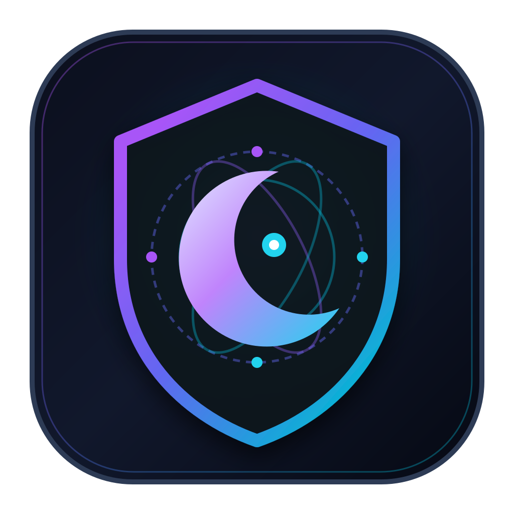
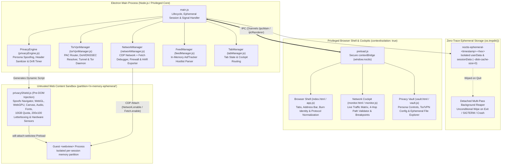
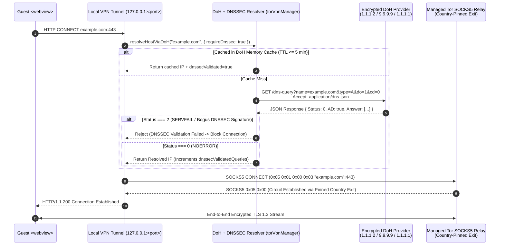
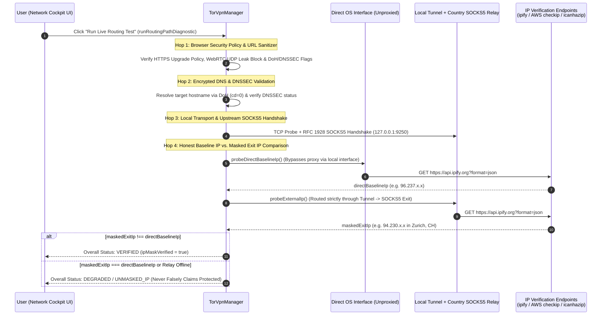

# NoctisBrowser

<p align="center">
  
</p>

<p align="center">
  <a href="https://github.com/othererik/noctisbrowser/actions/workflows/ci.yml"></a>
</p>

**NoctisBrowser** is a cross-platform, zero-trace ephemeral privacy and dark-web browser built on Chromium/Electron (`v41+` / Chromium `146`). It features a live CDP Network Observability Cockpit, Paranoid Anti-Fingerprinting, a built-in country-pinned Browser VPN tunnel, and native zero-config support for **Tor (`.onion`)** and decentralized dark-web protocols across **macOS**, **Linux**, and **Windows**.

---

## Table of Contents
1. [Key Capabilities](#key-capabilities)
2. [System Architecture & Network Data-Flow](#system-architecture--network-data-flow)
   - [1. High-Level Process & Sandbox Architecture](#1-high-level-process--sandbox-architecture)
   - [2. End-to-End Network Routing Data-Flow (Direct vs. Built-in VPN vs. Tor)](#2-end-to-end-network-routing-data-flow-direct-vs-built-in-vpn-vs-tor)
   - [3. Encrypted DNS-over-HTTPS (DoH) & Strict DNSSEC (`AD=1`) Pipeline](#3-encrypted-dns-over-https-doh--strict-dnssec-ad1-pipeline)
   - [4. Live 4-Hop Data Path Validator & Honest IP Masking Verification](#4-live-4-hop-data-path-validator--honest-ip-masking-verification)
   - [5. Routing Mode Comparison Matrix](#5-routing-mode-comparison-matrix)
3. [Prerequisites & Quick Start](#prerequisites--quick-start)
4. [Building Zero-Admin Portable Distributions](#building-zero-admin-portable-distributions)
5. [Testing & Verification Guide](#testing--verification-guide)
6. [CI/CD & Pull Request Gates](#cicd--pull-request-gates)
7. [Repository Structure](#repository-structure)

---

## Key Capabilities

### 1. Paranoid Anti-Fingerprinting & Stealth Engine
- **Coherent OS & Hardware Persona Spoofing**: Synchronizes HTTP `User-Agent`, `Sec-CH-UA-*` Client Hints headers, `Navigator.prototype` (`userAgent`, `appVersion`, `platform`, `userAgentData`, `hardwareConcurrency`, `deviceMemory`), and WebGL unmasked GPU vendor/renderer across macOS Apple Silicon, Windows 11 NVIDIA RTX, and Linux AMD Radeon presets.
- **Dynamic Runtime Parameter Drift**: Continuously rotates cryptographic noise seeds and sub-audible audio harmonics during runtime to defeat cross-session correlation.
- **Viewport Letterboxing (`200×100` Bucket Quantization)**: Standardizes `window.innerWidth`, `window.innerHeight`, and `visualViewport` dimensions to `200×100` pixel buckets to defeat screen-dimension and window-resize tracking.
- **WebGPU, Canvas, Font & Audio Perturbation**: Injects deterministic seed-driven micro-jitter into `CanvasRenderingContext2D`, `WebGLRenderingContext`, `AudioBuffer`, `OfflineAudioContext`, `measureText`, and `DOMRect` while masking `navigator.gpu` adapter descriptors.
- **Hardware Sensor, Gamepad, Storage Quota & Keyboard Shield**:
  - Standardizes `navigator.storage.estimate()` to a uniform `10.0 GB` quota to defeat incognito and disk-size fingerprinting.
  - Blocks `Accelerometer`, `Gyroscope`, `Magnetometer`, `AmbientLightSensor`, `DeviceOrientation`, `navigator.getGamepads()`, and `navigator.xr`.
  - Masks `navigator.keyboard.getLayoutMap()` to a standardized US-QWERTY layout and normalizes HDR / P3 wide-gamut `matchMedia` probes.
- **Shadow Mode (OS Screen-Capture Protection)**: Optional window compositor flag (`setContentProtection`) that blocks unauthorized third-party screen recording and screenshot telemetry.
- **Instant "Burn Identity" Panic Button**: One-click toolbar button that immediately purges all ephemeral caches/storage, rotates the fingerprint persona and noise seeds, rotates the active Tor/VPN circuit, clears network logs, and resets open tabs.

### 2. Tor (`.onion`) & Decentralized Dark Web Protocols
NoctisBrowser natively recognizes and routes 7 dark-web and decentralized protocols without ever leaking addresses to clearnet search engines:
- **Tor Hidden Services (`.onion`, `tor://`)**: Uses bundled native Tor binaries (`bin/macos`, `bin/linux`, `bin/windows`) or auto-detects local Tor SOCKS5 daemons (`127.0.0.1:9050` / `9150`), and provides an optional HTTPS Onion Gateway Bridge (`onion.ly` / `tor2web.org`).
- **Invisible Internet Project (`.i2p`, `i2p://`)**: Routes eepsites via local I2P HTTP/SOCKS proxies (`127.0.0.1:4444` / `4447`) or configurable outproxy bridges.
- **Lokinet (`.loki`, `loki://`)**: Supports LLARP service node `.loki` SNApps.
- **IPFS & IPNS (`ipfs://`, `ipns://`)**: Resolves content-addressed CIDs via local Kubo daemon (`127.0.0.1:8080`) or privacy-preserving gateways (`https://dweb.link`).
- **Ethereum Name Service (`.eth`)**: Resolves decentralized `.eth` domains via `.eth.limo`.
- **ZeroNet (`zero://`, `.bit`)**: Routes peer-to-peer ZeroSites via local ZeroNet node (`127.0.0.1:43110`).
- **Hyphanet / Freenet (`hyphanet://`, `freenet:`)**: Routes freesites via local FProxy (`127.0.0.1:8888`).

### 3. Built-in Browser VPN, Country-Pinned Exit Relays & Honest Egress Verification
- **True Multi-Hop IP Masking (`SOCKS5` Exit Relay + Encrypted DoH/DNSSEC Tunnel)**: Chains the local header-stripping HTTP/HTTPS `CONNECT` tunnel (`127.0.0.1:<tunnelPort>`) through a managed user-space SOCKS5 exit relay with GeoIP country pinning (`{ch}` Switzerland, `{is}` Iceland, `{se}` Sweden, `{us}` United States, `{de}` Germany) so your public egress IP genuinely changes without requiring root/TUN kernel privileges.
- **Honest Baseline vs. Masked IP Verification**: Automatically measures your unproxied `directBaselineIp` and compares it against the tunnel's `maskedExitIp`. The 4-Hop Data Path Validator (`noctis://monitor`) only reports `VERIFIED` when `maskedExitIp !== directBaselineIp` and fails closed (`502` / `UNMASKED_IP` warning) if the upstream exit relay is offline.
- **Cross-Platform Bundled Daemon (`macOS`, `Linux`, `Windows`)**: Bundles native `aarch64` and `x86_64` macOS Mach-O binaries, Linux `x86_64` ELF binaries + shared libraries (`libevent-2.1.so.7`, `libssl.so.3`, `libcrypto.so.3`), Windows `x86_64` PE executable (`tor.exe`), and IPv4/IPv6 GeoIP databases (`bin/geoip/{geoip,geoip6}`) with automatic `LD_LIBRARY_PATH` / `DYLD_LIBRARY_PATH` / `PATH` resolution.
- **Strict Network Kill-Switch & Circuit Rotation (`NEWNYM`)**: Flushes DoH caches, closes active tunnel sockets, clears Chromium host/auth caches, and sends `SIGNAL NEWNYM` to Tor ControlPort (`9051`/`9251`).

### 4. Zero-Trace Ephemeral Architecture & Transparent Storage Inspector
- Every launch creates an isolated session directory in the OS temp directory (`os.tmpdir()`) with Chromium disk caches disabled (`--disable-http-cache --disk-cache-size=0 --incognito`).
- The **Privacy Vault (`noctis://vault`)** provides a live file explorer showing every single ephemeral file in temp storage, categorized by Cookies, Local Storage, IndexedDB, and Config, with one-click purge and guaranteed background reaper cleanup on exit.

### 5. Real-Time CDP Network Cockpit & Monitor (`noctis://monitor`)
- Inspect live requests, group traffic by destination host or initiator script, validate the live 4-hop routing path (`Run Live Routing Test`), pause/intercept requests with breakpoints, block ad/tracker hosts, opt-in to community blocklist feeds (Peter Lowe, StevenBlack, AdGuard DNS), and export standard HAR archives.

---

## System Architecture & Network Data-Flow

### 1. High-Level Process & Sandbox Architecture

NoctisBrowser enforces strict isolation between the **Electron Main Process**, the **Privileged Browser UI & Cockpits**, and **Untrusted Guest Web Content** running inside ephemeral `<webview>` sandboxes:



---

### 2. End-to-End Network Routing Data-Flow (`Direct` vs. `Built-in VPN` vs. `Tor`)

Every network request initiated by a guest `<webview>` passes through **four sequential defense and routing layers** before any packet leaves your machine:

1. **Layer 1 — Protocol Normalization & Request Interception (`onBeforeRequest`)**:
   - **Dark Web Protocol Resolver**: Intercepts `.onion`, `tor://`, `.i2p`, `i2p://`, `.loki`, `loki://`, `ipfs://`, `ipns://`, `.eth`, `zero://`, and `hyphanet://` before address bar submission so non-ICANN domains are never leaked to clearnet search engines.
   - **Firewall & Tracker Blocklist**: Blocks 31+ built-in ad/tracker/sponsored-feed networks (`doubleclick.net`, `googlesyndication`, `taboola`, `outbrain`, `facebook.net`, `hotjar`, `clarity.ms`, etc.) plus any enabled community blocklists.
   - **URL Query Sanitizer**: Strips tracking parameters (`utm_*`, `fbclid`, `gclid`, `msclkid`, `twclid`, `ttclid`, `mc_eid`, `igshid`, `_hsenc`, `vero_id`, `mkt_tok`, etc.).
   - **Strict Transport Upgrade (`requireSecureTraffic`)**: Automatically upgrades plaintext `http://` and `ws://` requests to `https://` and `wss://` (while exempting loopback `127.0.0.1`/`localhost` and self-authenticated overlay networks `.onion`/`.i2p`/`.loki`).
2. **Layer 2 — Header Sanitization (`onBeforeSendHeaders`)**:
   - Rewrites `User-Agent` and `Sec-CH-UA*` Client Hints to match the active Privacy Vault persona (`macOS Apple Silicon`, `Windows 11 RTX`, or `Linux AMD`), strips `X-Forwarded-For` / `Referer` / `Etag` tracking headers, and sends `DNT: 1` and `Sec-GPC: 1`.
3. **Layer 3 — Dynamic Chromium PAC Proxy Router (`generatePacScript()`)**:
   - Evaluates every hostname and routes it according to the active mode (`direct`, `built-in-vpn`, `tor`, `i2p`, or `custom`) and Kill-Switch state.
4. **Layer 4 — Egress Transport & Country-Pinned SOCKS5 Exit Relay**:
   - Executes DNS-over-HTTPS with DNSSEC validation and transports TCP/TLS streams via the selected anonymity network.

```mermaid
flowchart TD
  Req["Guest &lt;webview&gt; Request<br/>(HTTP / HTTPS / WS / WSS / Dark Web URI)"]
  
  subgraph Layer1["Layer 1: Interception, Firewall &amp; Protocol Resolution"]
    Proto["Protocol Resolver (torVpnManager.resolveProtocolUrl)<br/>.onion | .i2p | .loki | ipfs:// | ipns:// | .eth | zero:// | hyphanet://"]
    Block["Firewall &amp; Tracker Filter (networkManager + privacyEngine)<br/>Blocks Ad/Tracker Hosts &amp; Strips utm_*/fbclid/gclid Params"]
    Upgrade["HTTPS-Only Enforcer (requireSecureTraffic)<br/>Upgrades http:// &#8594; https:// and ws:// &#8594; wss://"]
  end

  subgraph Layer2["Layer 2: Header Sanitization (onBeforeSendHeaders)"]
    Headers["Coherent Persona Headers<br/>Spoofs User-Agent &amp; Sec-CH-UA-* | Strips Referer &amp; Client-IP"]
  end

  subgraph Layer3["Layer 3: Chromium Session Proxy / PAC Router (generatePacScript)"]
    PAC{"Active Routing Mode?"}
  end

  subgraph ModeDirect["Mode A: Direct Clearnet (mode = 'direct')"]
    DirectSplit{".onion / .i2p Host?"}
    DirectClear["DIRECT Clearnet Socket<br/>+ Chromium DoH (https://1.1.1.2/dns-query)"]
    DirectOnion["Auto Split-Tunnel to Local Tor SOCKS5<br/>(127.0.0.1:9050 / 9250) or HTTPS Onion Bridge"]
  end

  subgraph ModeVPN["Mode B: Built-in Browser VPN (mode = 'built-in-vpn')"]
    LocalTunnel["Local Encrypted HTTP/HTTPS CONNECT Tunnel<br/>(127.0.0.1:&lt;tunnelPort&gt; — Strips X-Forwarded-For / Via / From)"]
    DoHDNS["DoH + Strict DNSSEC Resolver (resolveHostViaDoH)<br/>Queries 1.1.1.2 / 9.9.9.9 / 1.1.1.1 with cd=0 &amp; Verifies AD=1"]
    VpnRelayCheck{"Managed Tor SOCKS5<br/>Exit Relay Online?"}
    VpnSocks["Country-Pinned Managed Tor SOCKS5 Relay (127.0.0.1:9250)<br/>ExitNodes {ch} | {is} | {se} | {us} | {de} + StrictNodes 1"]
    VpnFailClosed["Fail-Closed 502 / Kill-Switch Blackhole (127.0.0.1:9)<br/>Zero Unmasked Local IP Leakage"]
  end

  subgraph ModeTor["Mode C: Tor Onion Router (mode = 'tor')"]
    TorCheck{"Tor SOCKS5 Daemon<br/>(9050 / 9250) Online?"}
    TorSocks["3-Hop Tor Circuit via SOCKS5h<br/>Guard &#8594; Middle &#8594; Exit / .onion Rendezvous"]
    TorKS{"Kill-Switch Enabled?"}
    TorBlackhole["Blackhole Proxy (PROXY 127.0.0.1:9)<br/>Blocks All Clearnet Traffic"]
  end

  Egress["Destination Server / Hidden Service<br/>(Sees Only Masked Exit IP &amp; Spoofed Persona)"]

  Req --> Proto --> Block --> Upgrade --> Headers --> PAC

  PAC -- "direct" --> DirectSplit
  DirectSplit -- "Clearnet Host" --> DirectClear --> Egress
  DirectSplit -- ".onion / .i2p" --> DirectOnion --> Egress

  PAC -- "built-in-vpn" --> LocalTunnel --> DoHDNS --> VpnRelayCheck
  VpnRelayCheck -- "Yes (Relay Active)" --> VpnSocks --> Egress
  VpnRelayCheck -- "No (Offline)" --> VpnFailClosed

  PAC -- "tor" --> TorCheck
  TorCheck -- "Yes" --> TorSocks --> Egress
  TorCheck -- "No" --> TorKS
  TorKS -- "Kill-Switch ON" --> TorBlackhole
  TorKS -- "Kill-Switch OFF" --> LocalTunnel
```



---

### 3. Encrypted DNS-over-HTTPS (DoH) & Strict DNSSEC (`AD=1`) Pipeline

NoctisBrowser prevents ISP DNS snooping and DNS cache poisoning by enforcing **DNS-over-HTTPS (DoH)** with **DNSSEC validation** enabled by default (`forceDnssec: true`):



- **Zero Local DNS Leaks**: When routing through the Built-in VPN or Tor SOCKS5 relay, domain names are passed using **SOCKS5 domain-name addressing (`ATYP = 0x03`)** so final DNS resolution occurs remotely inside the encrypted exit circuit while DoH (`cd=0`) validates DNSSEC integrity.
- **Circuit Rotation Flush**: Clicking **New Circuit** or **Burn Identity** immediately clears `dohCache`, closes all active tunnel sockets, flushes Chromium's `HostResolverCache` and `AuthCache`, and dispatches `SIGNAL NEWNYM` to the Tor ControlPort (`9051`/`9251`).

---

### 4. Live 4-Hop Data Path Validator & Honest IP Masking Verification

To ensure the browser **never falsely claims** VPN protection when traffic is actually exiting from your local IP, NoctisBrowser includes an automated **Baseline vs. Exit IP Verification Engine** and an interactive **4-Hop Data Path Validator** inside the Network Cockpit (`noctis://monitor`):



---

### 5. Routing Mode Comparison Matrix

| Feature / Behavior | Direct Mode (`direct`) | Built-in Browser VPN (`built-in-vpn`) | Tor Onion Router (`tor`) | I2P Eepsite Router (`i2p`) |
| :--- | :--- | :--- | :--- | :--- |
| **Clearnet Routing** | Direct (`DIRECT`) | Local Tunnel $\rightarrow$ Country-Pinned SOCKS5 Exit Relay | 3-Hop Tor SOCKS5h (`127.0.0.1:9050`/`9250`) | Local Tunnel / I2P Outproxy |
| **Public Egress IP** | Local ISP IP | **Masked** (`{ch}`, `{is}`, `{se}`, `{us}`, `{de}` Exit Node) | **Masked** (Dynamic Tor Exit Relay) | **Masked** (I2P / Tunnel) |
| **`.onion` Hidden Services** | Auto Split-Tunneled to Tor SOCKS5 / Bridge | Native via Bundled Tor Daemon | Native via Bundled Tor Daemon | Native via Bundled Tor Daemon |
| **DNS Resolution** | Chromium DoH (`1.1.1.2`) | DoH (`cd=0`) + Remote SOCKS5 (`ATYP 0x03`) | Remote Tor `DNSPort` / SOCKS5h (`ATYP 0x03`) | DoH + I2P Naming Service |
| **DNSSEC Enforcement** | Forced (`AD=1` verified) | Forced (`AD=1` verified) | Enforced by Exit Relay + DoH | Forced (`AD=1` verified) |
| **Plaintext HTTP (`http://`)** | Upgraded when `requireSecureTraffic` ON | Automatically Upgraded to `https://` | Automatically Upgraded to `https://` (except `.onion`) | Automatically Upgraded (except `.i2p`) |
| **If Upstream Daemon Drops** | N/A | **Fails Closed (`502`)** — Never leaks local IP | **Blackholes (`127.0.0.1:9`)** when Kill-Switch ON | Blackholes when Kill-Switch ON |

---

## Prerequisites & Quick Start

### Prerequisites
- **Node.js**: `v18+` or `v20+` (LTS recommended)
- **npm**: Included with Node.js
- **No administrator/root privileges or external Tor installation required** — native Tor binaries and GeoIP databases for macOS (`arm64`/`x64`), Linux (`x64`), and Windows (`x64`) are bundled inside `bin/`.

### Clone, Install & Run
```bash
# 1. Clone the repository
git clone https://github.com/othererik/noctisbrowser.git
cd noctisbrowser

# 2. Install dependencies
npm install

# 3. Start NoctisBrowser
npm start
# Or use the zero-admin OS launchers directly:
./start.sh      # macOS & Linux
start.bat       # Windows (Command Prompt / PowerShell / Double-Click)
```

> **Note for Linux Users (Fedora, Ubuntu, Debian, Arch)**: NoctisBrowser automatically appends `--no-sandbox` and `--disable-setuid-sandbox` via [`scripts/run_electron.js`](scripts/run_electron.js) on Linux when running as a portable/user-space app so no `root`-owned `chrome-sandbox` SUID binary is needed.

---

## Building Zero-Admin Portable Distributions

You can generate self-contained, zero-admin portable folders in `dist/` that require **no installer and no admin/root privileges**:

```bash
# Optional: regenerate SVG/PNG/ICNS icons
npm run build:icons

# Build Zero-Admin Portable Bundles for macOS, Linux x64, and Windows x64
npm run dist:portable
```

### Generated Artifacts in `dist/`
| Platform | Output Directory | How to Run (Zero-Admin) |
| :--- | :--- | :--- |
| **macOS (`arm64` / `x64`)** | `dist/NoctisBrowser.app`<br>`dist/NoctisBrowser-macOS-Portable/` | Double-click `NoctisBrowser.app` or `Launch-NoctisBrowser.command` (automatically strips Gatekeeper quarantine in user-space) |
| **Linux (`x86_64`)** | `dist/NoctisBrowser-Linux-x64-Portable/` | Run `./launch-noctis-browser.sh` or open `NoctisBrowser.desktop` |
| **Windows (`x64`)** | `dist/NoctisBrowser-Windows-x64-Portable/` | Double-click `Launch-NoctisBrowser.bat` |

---

## Testing & Verification Guide

NoctisBrowser includes an automated verification suite covering unit logic, anti-fingerprinting coherence, adblock/feed rules, exhaustive network state combinations, cross-platform Tor/VPN IP masking, and headless Electron E2E browser tests.

### 1. Run Cross-Platform Unit & Routing Suite (Fast, No Display Required)
Runs on macOS, Linux, and Windows without requiring a GUI display server:
```bash
npm run test:unit
```
Included unit & routing verifications:
- `test/verify.js`: Core tab management, firewall rules, and HAR export.
- `test/verify_privacy.js`: Fingerprint profile generation, header sanitization, and URL tracker stripping.
- `test/verify_adblock_feed.js`: Built-in ad/tracker/feed rules and external hostlist parser.
- `test/verify_vault_and_fingerprint.js`: OS/GPU/Client-Hints coherence and runtime drift rotation.
- `test/verify_exhaustive_network_states.js`: Exhaustive matrix of `direct`, `built-in-vpn` (all 5 country relays), `tor`, Kill-Switch ON/OFF, DNSSEC ON/OFF, and Require-Secure ON/OFF, plus 4-hop Data Path Validator checks.
- `test/verify_cross_platform_vpn_and_portable.js`: Verifies macOS Mach-O, Linux ELF + `.so`, and Windows PE (`tor.exe`) binaries, GeoIP files, live `directBaselineIp !== maskedExitIp` VPN IP masking, and honest `UNMASKED_IP` / `DEGRADED` detection when upstream relays are offline.

### 2. Run Electron Headless E2E Browser Suite
Spawns headless Electron browser instances and guest `<webview>` sandboxes to verify DOM/Navigator spoofing, Viewport Letterboxing, Ephemeral session wiping, and Vault UI controls:
```bash
# On macOS or Windows (or Linux with a display server):
npm run test:e2e

# On headless Linux servers / CI runners using Xvfb:
xvfb-run --auto-servernum npm run test:e2e
```

### 3. Run the Full Combined Test Suite (`unit` + `e2e`)
```bash
npm test
```

---

## CI/CD & Pull Request Gates

GitHub Actions automatically runs on every push to `main`/`release/**` and acts as a **Pull Request Gate** via [`.github/workflows/ci.yml`](.github/workflows/ci.yml):
1. **Unit & Portable Build Matrix Gate (`ubuntu-latest`, `macos-latest`, `windows-latest`)**:
   - Runs `npm run test:unit` across Linux, macOS, and Windows runners.
   - Runs `npm run dist:portable` to verify zero-admin portable bundle packaging on every OS.
2. **Electron Headless E2E Matrix Gate (`ubuntu-latest`, `macos-latest`, `windows-latest`)**:
   - Runs `npm run test:e2e` across Linux (via `xvfb-run`), macOS, and Windows to validate live Chromium guest webviews, anti-fingerprinting shields, and ephemeral session cleanup.

---

## Repository Structure

```text
noctisbrowser/
├── .github/workflows/ci.yml      # Multi-OS GitHub Actions CI & Pull Request Gates
├── assets/                       # Custom SVG, PNG, and macOS ICNS branding assets
├── bin/
│   ├── geoip/                    # Bundled IPv4 (geoip) & IPv6 (geoip6) databases
│   ├── linux/x86_64/             # Native Linux x86_64 Tor ELF binary + .so libraries
│   ├── macos/aarch64/            # Native macOS Apple Silicon Tor binary + libtor.dylib
│   ├── macos/x86_64/             # Native macOS Intel Tor binary + libtor.dylib
│   └── windows/x86_64/           # Native Windows x64 Tor PE executable (tor.exe)
├── scripts/
│   ├── generate_icons.js         # Generates icon.png & icon.icns from icon.svg
│   ├── package_macos.js          # Packages standalone macOS NoctisBrowser.app
│   ├── package_portable.js       # Builds Zero-Admin Portable bundles (macOS/Linux/Windows)
│   └── run_electron.js           # Cross-platform Electron CLI wrapper (--no-sandbox on Linux)
├── src/
│   ├── main/                     # Electron Main process (TorVpnManager, PrivacyEngine, CDP NetworkManager)
│   └── renderer/                 # Browser UI, Network Cockpit, Privacy Vault & Guest Webview Shield
├── test/                         # Automated Unit, Exhaustive Routing & Headless Electron E2E Suites
├── package.json
├── start.bat                     # Zero-Admin Windows launcher
└── start.sh                      # Zero-Admin POSIX launcher for macOS & Linux
```
